# 绿益公益 产品需求文档（PRD）

> **文档状态**：草案（Draft）
> **版本**：v0.1　**日期**：2026-11-19　**作者**：Agent + 用户
> **评审状态**：待评审
> **关联需求分析**：绿益公益-需求分析文档.md

---

## 1. 背景与目标

### 1.1 背景

绿益公益 / 绿益汇百川公益平台（青岛，2018 年起运营）已有成熟的线下公益与内容矩阵，但捐赠、志愿、购物、宣传分散在不同平台。本项目以微信小程序为载体，整合"宣传 — 物资捐赠 — 商品购买 — 免费申领 — 活动志愿"为可信、可激励、可分享的闭环。详见关联需求分析文档。

### 1.2 业务目标与指标（目标值草案待确认，见 OQ-17）

| 目标 | 指标 | 基线/目标值（草案） | 备注 |
|------|------|-------------------|------|
| 提升物资捐赠参与 | 月捐赠单量、参与人数 | 待定 | 上线后采集基线 |
| 沉淀用户贡献 | 荣誉档案激活率、证书分享率 | 待定 | — |
| 内容带动转化 | 分享带来的新增参与占比 | 待定 | 需分享埋点 |
| 激励闭环 | 积分发放→核销转化率 | 待定 | 依赖 OQ-16 |
| 志愿激励 | 活动报名→发证完成率 | 待定 | 依赖 OQ-09a |

---

## 2. 问题定义

**谁**（公益组织与参与者）在**什么场景**（闲置物资捐赠、志愿活动、公益购物与帮扶）下遇到**什么问题**（缺线上闭环、贡献难量化、凭证与宣传分散），导致**什么影响**（转化低、贡献不被看见、公信力难沉淀）。

根因与 JTBD 详见需求分析文档 §2。

---

## 3. 用户、场景与现状

角色与边界场景详见需求分析文档 §3。核心用户故事：

- 作为**捐赠人**，我想捐出旧衣并看到评估结果与证书，以便我的贡献被认可。
- 作为**购物用户**，我想用公益积分抵扣现金，以便我的善意得到回馈。
- 作为**申领人**，我想免费领物资只付运费，以便获得实际帮助。
- 作为**志愿者**，我想报名活动并在结束后拿到官方承认证书，以便用于升学/求职/评优。
- 作为**评估员/运营**，我想高效评估与维护内容、商品、活动，以便平台运转。

---

## 4. 方案与范围

### 4.1 产品形态与信息架构

**C 端小程序**（原生）主要模块：首页/内容（图文、短视频）→ 公益项目 → 物资捐赠 → 公益商城（购物车、结算、订单）→ 免费申领 → 活动与志愿者 → 荣誉档案（证书、积分）→ 我的（登录、地址、记录）。

**后台管理端**（SpringBoot）主要模块：内容/项目管理、商品管理、物资评估工作台、订单/捐赠/申领记录、荣誉与积分规则配置、活动与志愿者管理、证书管理、账号角色权限、数据看板。

### 4.2 业务流程、状态与系统协作

- **MVP 主路径业务流程图**（必填，见 §4.3 图 1）
- 物资捐赠评估流程、商品购买流程、免费申领+运费流程、活动生命周期流程（图 2~5）
- 订单/捐赠记录状态流转（图 8）
- 系统协作见架构图（图 6）

### 4.3 标准可视化图

**图 1 · MVP 主路径业务流程图**（物资捐赠 → 评估 → 证书/积分）

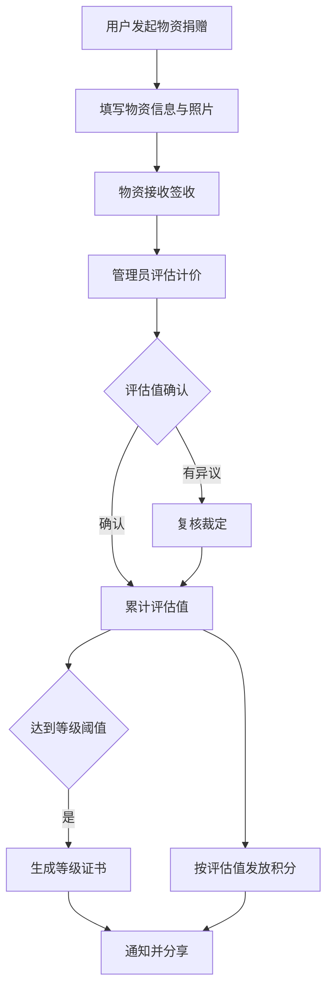

**图 2 · 商品购买与积分抵扣流程**

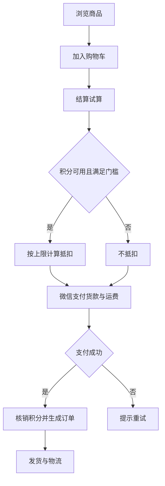

**图 3 · 免费申领与运费试算流程**

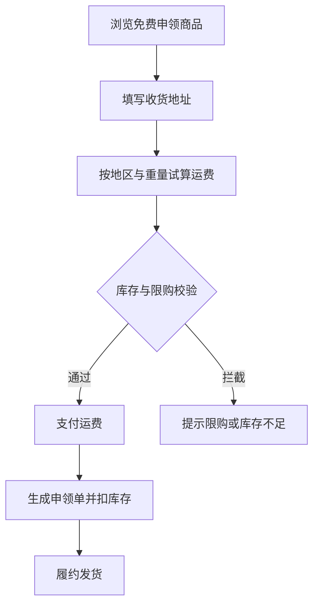

**图 4 · 公益活动生命周期流程**

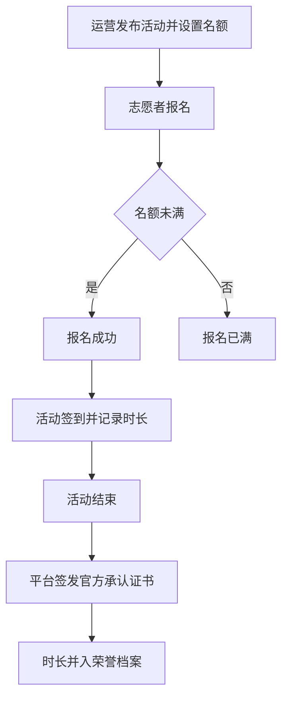

**图 5 · 积分发放与抵扣流转图（含退款回退）**

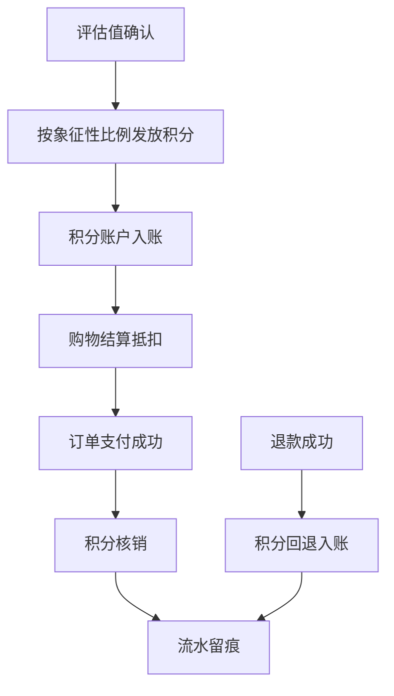

**图 6 · 系统架构图**

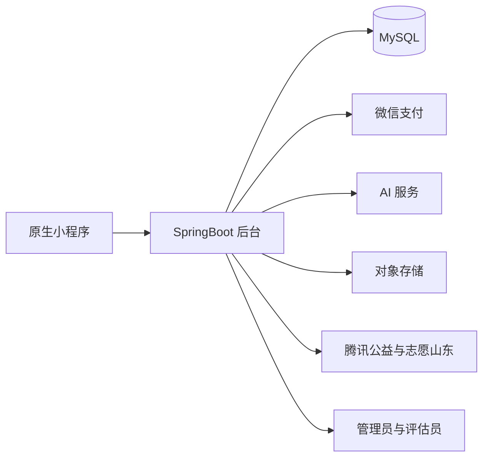

**图 7 · 物资评估时序图**

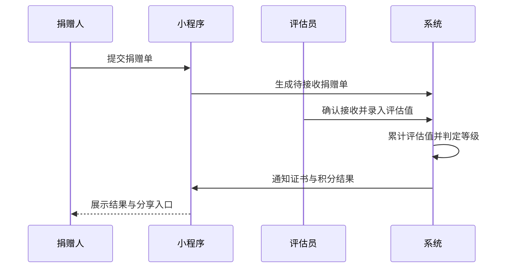

**图 8 · AI 客服时序图**

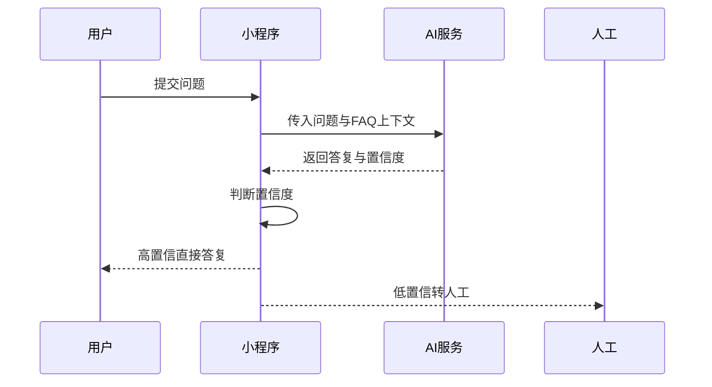

**图 9 · 订单与捐赠记录状态图**

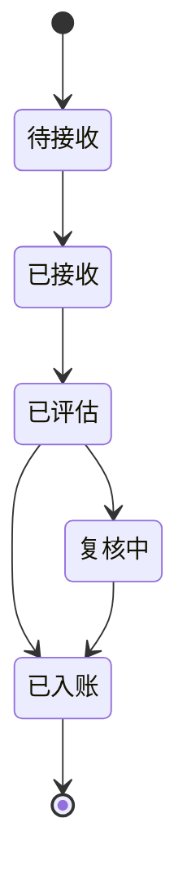

**图 10 · 核心实体 ER 图**

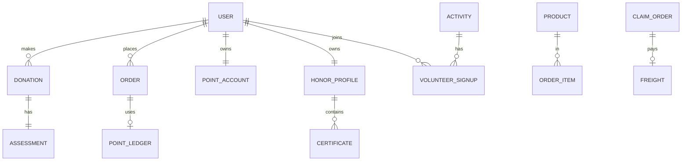

**图 11 · 统一荣誉档案数据流转图**

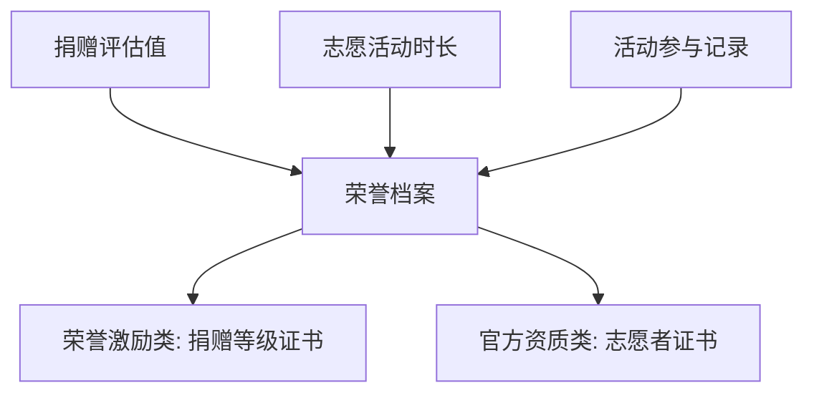

> 所有图为草案，节点细节以 §8 数据定义与功能原子表为准。

### 4.4 最小闭环 MVP 场景

> 当**公益捐赠人**在**手上有闲置旧衣想做公益**的场景中，需要**便捷捐出并得到贡献被认可的证明**时，系统通过**发起捐赠 + 管理员评估 + 等级证书 + 积分发放**的最小能力组合，使其得到**可查询、可分享的贡献凭证**这一可验证结果。

### 4.5 范围（用户决定 V1 全量）

**V1 必须达到**：物资捐赠与评估、商品购买、积分抵现、免费申领+运费、活动招募+官方证书、统一荣誉档案、内容宣传、后台管理、AI 能力。

**明确推迟（V1.1）**：仓储系统对接、志愿山东时长接口、物流 API 实时计价（按 OQ 结论）。

**Out of Scope**：现金募捐、公益金融化、线下作业管理。

### 4.6 方案取舍

用户明确决定 V1 全量交付，取舍依据（理论最小闭环与建议）保留在需求分析文档 §9，供排期参考；本 PRD 按全量范围定义，高风险项标注前置依赖。

---

## 5. 功能需求（EARS）

| FR | EARS类型 | 需求描述 | 来源功能原子 | 优先级 |
|----|----------|----------|--------------|--------|
| FR-001 | Event-driven | 当用户提交物资捐赠信息时，系统应生成捐赠单并置为待接收状态 | FA-001 | Must |
| FR-002 | Event-driven | 当评估员确认接收物资时，系统应将捐赠单置为已接收并通知用户 | FA-002 | Must |
| FR-003 | Event-driven | 当评估员提交评估值时，系统应记录评估人、时间与说明并置为已评估 | FA-003 | Must |
| FR-004 | State-driven | 当捐赠单处于已接收状态时，系统应允许评估员录入评估值 | FA-003 | Must |
| FR-005 | Event-driven | 当评估值确认时，系统应累加用户累计评估值并计算对应积分 | FA-005, FA-040 | Must |
| FR-006 | Event-driven | 当用户累计评估值达到等级阈值时，系统应生成对应等级的荣誉证书 | FA-030, FA-031 | Must |
| FR-007 | Unwanted | 若用户对评估值提出异议，系统应进入复核流程并保留原评估记录 | FA-004 | Should |
| FR-008 | Event-driven | 当用户将商品加入购物车时，系统应校验库存并更新购物车 | FA-011 | Must |
| FR-009 | Event-driven | 当用户进入结算时，系统应按积分规则和抵扣上限计算应付金额 | FA-012 | Must |
| FR-010 | Unwanted | 若积分不足或低于使用门槛或运费部分，系统应不予抵扣并提示原因 | FA-012 | Must |
| FR-011 | Event-driven | 当用户确认支付且回调验证通过时，系统应生成订单并核销相应积分 | FA-013, FA-042 | Must |
| FR-012 | Unwanted | 若支付回调校验失败，系统不得将订单标记为已支付，应提示重试 | FA-013 | Must |
| FR-013 | Event-driven | 当订单支付成功且用户申请退款时，系统应退款并回退相应积分 | FA-015, FA-043 | Should |
| FR-014 | Event-driven | 当用户提交免费申领时，系统应按地区与重量试算运费 | FA-021 | Must |
| FR-015 | Unwanted | 若申领超出限购或库存不足，系统应拦截申领并提示原因 | FA-023 | Must |
| FR-016 | Event-driven | 当申领人支付运费成功时，系统应生成申领单并扣减库存 | FA-022 | Must |
| FR-017 | Event-driven | 当运营发布活动时，系统应按名额开放报名并支持满员即止 | FA-050 | Must |
| FR-018 | Event-driven | 当志愿者报名且名额未满时，系统应记录报名（无审核流程） | FA-051 | Must |
| FR-019 | Event-driven | 当活动结束且志愿者有参与记录时，系统应签发官方承认的志愿者证书 | FA-032, FA-053 | Must |
| FR-020 | Event-driven | 当志愿时长产生时，系统应将其并入用户荣誉档案 | FA-052, FA-054 | Must |
| FR-021 | Ubiquitous | 系统应在荣誉档案中分类展示荣誉激励类与官方资质类凭证 | FA-033 | Must |
| FR-022 | Event-driven | 当运营发布图文或视频内容时，系统应展示并可被分享 | FA-060, FA-061, FA-062 | Should |
| FR-023 | Ubiquitous | 系统应对后台功能进行基于角色的权限控制 | FA-074 | Must |
| FR-024 | Event-driven | 当用户微信授权登录时，系统应创建或识别用户身份 | FA-080 | Must |
| FR-025 | Optional | 当智能推荐功能开启时，系统应基于用户行为对内容和商品排序 | FA-090 | Should |
| FR-026 | Optional | 当 AI 客服功能开启时，系统应对用户问题生成答复并返回置信度 | FA-091 | Should |
| FR-027 | Unwanted | 若 AI 客服置信度低于阈值，系统应转接人工客服 | FA-091 | Should |
| FR-028 | Optional | 当文案或海报生成功能开启时，系统应生成草稿等待人工确认，不得自动发布 | FA-092, FA-093 | Should |
| FR-029 | Optional | 当估值参考功能开启时，系统应给出物资估值参考区间且不得自动入账 | FA-094 | Should |
| FR-030 | Ubiquitous | 系统应记录所有 AI 输出的采纳、修改与拒绝情况并形成审计日志 | FA-095 | Must |

---

## 5A. AI/Agent 功能清单

| AI/Agent 功能 | 类型 | 关联 FR | 质量指标（草案） | 失败兜底 |
|---------------|------|---------|------------------|----------|
| 估值参考 | 分类/回归 | FR-029 | 参考采纳率、偏差率 | 评估员人工定价 |
| 智能推荐 | 排序 | FR-025 | 点击率、采纳率 | 热门/规则推荐 |
| AI 客服 | 检索生成 | FR-026, FR-027 | 解决率、转人工率 | 转人工 |
| 文案生成 | 生成 | FR-028 | 采纳率、修改率 | 人工撰写 |
| 海报生成 | 生成 | FR-028 | 采纳率、违规率 | 模板兜底 |

## 5B. Agent 工作设计

工作流与时序见需求分析文档 §8.1、§8.3，AI 客服时序见本文档 §4.3 图 8。职责说明见需求分析文档 §8.2。所有 AI 能力遵循"规则优先 → AI 辅助 → 人工确认 → 审计留痕"的分层模式。

## 5C. 提示词设计

产品级提示词草案见需求分析文档 §8.5；详细提示词包由下游 `prd-to-dev-spec` 细化。

---

## 6. 业务规则

| 规则ID | 规则内容 | 状态 |
|--------|----------|------|
| BR-001 | 捐赠仅接受闲置物资，无现金捐赠；物资价值以管理员评估为准，评估值为公益口径非交易价 | 确认；细则 OQ-02 |
| BR-002 | 评估须记录评估人、时间、说明；异议进入复核，原记录保留 | 确认 |
| BR-003 | 证书等级按累计评估值分级，示例阈值 100/500/1000 元 | **草案待确认（OQ-11）** |
| BR-004 | 活动志愿者证书由平台签发、具备官方承认资质；证书编号唯一、可验真；背书口径须准确表述 | 确认；依据 OQ-09a |
| BR-005 | 证书分两类：捐赠等级证书=荣誉激励类，志愿证书=官方资质类，档案中分开标注 | 确认 |
| BR-006 | 积分来自捐赠评估值，按象征性比例换算（示例 1 元=10 积分） | **草案待确认（OQ-16）** |
| BR-007 | 积分兑换率 1000 积分=10 元；购物抵扣须设单笔上限与最低门槛；运费不可用积分抵扣 | **上限门槛草案待确认（OQ-16）** |
| BR-008 | 退款时回退相应积分；积分有效期规则待定 | 确认；细则 OQ-16 |
| BR-009 | 免费申领先到先得、无资格审核；每人限领与库存上限以防冒领 | 确认；细则 OQ-12 |
| BR-010 | 运费按地区与重量计算；运费与捐赠清晰分账 | 确认；细则 OQ-13 |
| BR-011 | 活动招募先到先得、无审核，满员即止 | 确认 |
| BR-012 | 未成年人参与须取得监护人授权，数据最小化采集 | 确认；细则 OQ-10 |
| BR-013 | AI 输出仅作草稿或参考，须人工确认后生效；估值不自动入账 | 确认 |

---

## 7. 异常、边界与错误处理

| 场景 | 处理 |
|------|------|
| 评估争议 | 进入复核流程，二次裁定，保留原评估与复核记录 |
| 物资不符/拒收 | 签收时核对，不符则拒收并通知用户，捐赠单关闭 |
| 支付失败 / 重复回调 | 不置为已支付，幂等处理，提示重试 |
| 运费试算失败 | 提示稍后重试或人工客服介入，不生成订单 |
| 积分不足/超限 | 不抵扣并提示原因 |
| 积分回退异常 | 记录差异，人工对账 |
| AI 超时/低置信/违规输出 | 转人工或规则兜底，不自动发布/入账 |
| 内容审核不通过 | 退回运营修改，不对外展示 |

---

## 8. 权限与数据

### 8.1 角色与权限（RBAC，依赖 OQ-05）

| 角色 | 关键权限 |
|------|----------|
| C 端用户 | 捐赠、购物、申领、报名、查看答案与自身记录 |
| 内容编辑 | 内容/商品/活动维护 |
| 物资评估员 | 物资接收、评估、复核、台账（**新增角色**） |
| 运营管理员 | 订单/捐赠/申领管理、规则配置、证书管理 |
| 系统管理员 | 账号角色、全局配置、数据看板 |

### 8.2 数据定义（MySQL，字段级设计在下游细化）

- **USER** 用户：openid、昵称、角色、监护人授权标记。
- **DONATION** 捐赠单：单号、用户、物种类、数量、照片、状态、评估值。
- **ASSESSMENT** 评估记录：捐赠单、评估员、评估值、说明、时间、复核状态。
- **PRODUCT / ORDER / ORDER_ITEM** 商品与订单：商品、价格、库存、订单状态、支付信息。
- **POINT_ACCOUNT / POINT_LEDGER** 积分账户与流水：余额、收支类型、关联订单、时间。
- **HONOR_PROFILE / CERTIFICATE** 荣誉档案与证书：累计评估值、志愿时长、证书类型（荣誉/官方资质）、编号、验真信息。
- **ACTIVITY / VOLUNTEER_SIGNUP** 活动与报名：名额、报名记录、签到、时长。
- **CLAIM_ORDER / FREIGHT** 申领与运费：申领品、收货地址、运费金额、支付状态。
- **CONTENT** 内容：图文/视频、发布状态、素材引用。

### 8.3 外部系统/接口

微信登录、微信支付（**未开通，OQ-01**）、对象存储、AI 服务（OQ-06）、腾讯公益与志愿山东（数据是否打通见 OQ-14）、官方证书编号验真规则（OQ-09a）。

---

## 9. 非功能需求（NFR）

| 类型 | 要求 | 验收方式 |
|------|------|----------|
| 技术栈 | 前端原生小程序；后台 SpringBoot；数据库 MySQL（已有内网实例，凭据单独管理，不写入文档） | 架构评审 |
| 性能 | 小程序首屏与支付响应在可接受范围（具体阈值草案待定） | 压测/体验 |
| 安全 | 支付与捐赠数据加密传输、最小权限、审计日志 | 安全评审 |
| 合规 | 未成年人隐私与监护人授权；生成式 AI 内容标识；官方资质表述准确 | 法务评审 |
| 可靠性 | 支付回调幂等、积分流水一致、评估可追溯 | 对账测试 |
| 可观测 | AI 采纳/纠正/违规率、关键业务埋点 | 监控看板 |

---

## 10. 验收标准（GWT）

| AC | 场景 | Given-When-Then | 关联FR |
|----|------|-----------------|--------|
| AC-01 | 捐赠主成功 | Given 用户填写完整捐赠信息，When 提交，Then 生成可查询的捐赠单 | FR-001 |
| AC-02 | 评估入账 | Given 捐赠单已接收，When 评估员提交评估值，Then 评估值入账且可追溯评估人 | FR-003, FR-004 |
| AC-03 | 证书触发 | Given 累计评估值达到等级阈值，When 评估确认，Then 生成对应等级荣誉证书 | FR-006 |
| AC-04 | 积分发放 | Given 评估值确认，When 计算积分，Then 积分按象征性比例入账且来源可追溯 | FR-005 |
| AC-05 | 积分抵扣成功 | Given 用户积分满足门槛，When 结算，Then 按上限计算抵扣并拆分应付金额 | FR-009 |
| AC-06 | 运费不可抵扣 | Given 结算含运费，When 计算抵扣，Then 运费部分不计入抵扣 | FR-010 |
| AC-07 | 支付回调失败 | Given 支付回调校验失败，When 处理回调，Then 订单不置为已支付并提示重试 | FR-012 |
| AC-08 | 免费申领限购 | Given 用户已达限领上限，When 再次申领，Then 系统拦截并提示 | FR-015 |
| AC-09 | 运费支付下单 | Given 运费试算成功且库存充足，When 支付运费，Then 生成申领单并扣库存 | FR-016 |
| AC-10 | 活动报名满员 | Given 活动名额已满，When 用户报名，Then 报名被拒并提示已满 | FR-018 |
| AC-11 | 官方证书签发 | Given 活动结束且志愿者有参与记录，When 触发发证，Then 生成唯一编号、可验真的官方承认证书 | FR-019 |
| AC-12 | 荣誉分类展示 | Given 用户有多类贡献，When 查看荣誉档案，Then 荣誉激励类与官方资质类分开展示 | FR-021 |
| AC-13 | 评估争议复核 | Given 用户提出评估异议，When 复核完成，Then 原记录保留且结论可查 | FR-007 |
| AC-14 | AI 草稿需确认 | Given 用户触发文案/海报生成，When 生成草稿，Then 草稿需人工确认后才可发布 | FR-028 |
| AC-15 | AI 估值不自动入账 | Given 估值参考开启，When 返回估值区间，Then 该值仅作参考不自动写入评估值 | FR-029 |
| AC-16 | AI 低置信转人工 | Given AI 客服置信度低于阈值，When 返回答复，Then 转接人工客服 | FR-027 |
| AC-17 | 越权拦截 | Given 非评估员账号，When 访问评估工作台，Then 拒绝访问 | FR-023 |
| AC-18 | 退款积分回退 | Given 订单退款成功，When 处理退款，Then 回退相应积分并记录流水 | FR-013 |

---

## 11. 优先级、版本与成功度量

### 11.1 优先级（MoSCoW）

- **Must**：物资捐赠与评估、商品购买、积分抵现、免费申领+运费、活动招募+官方证书、荣誉档案、基础登录与权限、证书签发验真、AI 审计日志。
- **Should**：内容/短视频、分享裂变、AI 推荐/客服/文案/海报/估值参考、数据看板、评估复核、售后退款。
- **Could**：公益打卡、积分有效期管理。
- **Won't（本期）**：现金募捐、公益金融化、仓储/志愿山东/物流 API 深度对接。

### 11.2 路线图

- **V1**：全量上线（依赖 OQ-01 支付商户、OQ-09a 证书资质、OQ-16 积分规则关闭）。
- **V1.1**：按 OQ 结论推进仓储对接、志愿山东时长打通、物流实时计价。

### 11.3 指标与埋点

捐赠单量、评估完成时长、证书生成与分享数、积分发放/核销、申领完成率、活动报名→发证率、AI 采纳/纠正/违规率。

### 11.4 风险与未决问题

见需求分析文档 §10；关键前置：OQ-01、OQ-09a、OQ-16。

### 11.5 需求追溯表

| 业务目标 | 功能原子 | FR | AC | OQ |
|----------|----------|----|----|----|
| 闲置物资数字化捐赠 | FA-001, FA-002, FA-003, FA-007 | FR-001, FR-002, FR-003, FR-004 | AC-01, AC-02 | OQ-02, OQ-03 |
| 贡献可激励 | FA-005, FA-030, FA-031, FA-040, FA-041 | FR-005, FR-006 | AC-03, AC-04 | OQ-11, OQ-16 |
| 积分抵现闭环 | FA-012, FA-013, FA-042, FA-043 | FR-009, FR-010, FR-011, FR-013 | AC-05, AC-06, AC-18 | OQ-01, OQ-16 |
| 帮扶履约 | FA-020~FA-024 | FR-014, FR-015, FR-016 | AC-08, AC-09 | OQ-12, OQ-13 |
| 志愿激励与官方证书 | FA-050~FA-054, FA-032 | FR-017~FR-020 | AC-10, AC-11, AC-12 | OQ-09a, OQ-14 |
| 内容传播 | FA-060~FA-063 | FR-022 | — | OQ-09 |
| AI 辅助提效 | FA-090~FA-095 | FR-025~FR-030 | AC-14~AC-16 | OQ-06, OQ-07 |

---

## 12. 下游交付准备

| 检查项 | 状态 | 说明 |
|--------|------|------|
| PRD 是否已人工评审 | 待确认 | 当前为草案 v0.1 |
| MVP 场景与 V1 范围 | 已定义 | V1 全量（用户决定） |
| FA / FR / AC / 追溯表 | 已具备 | 见 §5、§10、§11.5 |
| 业务规则、数据、权限、异常、NFR | 已具备 | 见 §6~§9 |
| 可视化图或缺图说明 | 已具备 | 见 §4.3，共 11 张图 |
| 未决问题是否关闭或有负责人 | 否 | 17 项 OQ，关键前置 OQ-01/09a/16 |
| 示例数值是否标注草案 | 是 | 阈值、积分比例、上限门槛等均标注 |
| 凭据是否落文档 | 否 | 数据库凭据不写入 |
| 是否可进入 prd-to-dev-spec | 否（需先评审并关闭关键 OQ） | 人工批准后再交接 |

> 本文档为草案，人工评审通过并关闭关键 OQ 后方可标记为基线，进入下游 `prd-to-dev-spec`。
