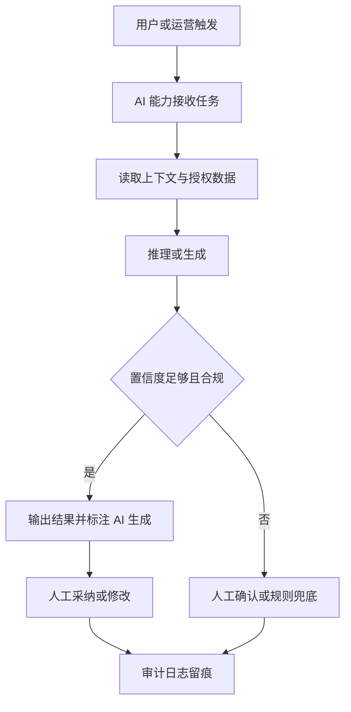

# 绿益公益 需求分析文档

> **文档状态**：草案（Draft）
> **版本**：v0.1　**日期**：2026-11-19　**作者**：Agent + 用户
> **评审状态**：待评审
> **关联 PRD**：绿益公益-产品需求文档-PRD.md

---

## 0. 需求来源与分析说明

本文档把一段模糊的产品设想（"做一个绿益公益小程序，宣传 + 销售公益产品"）经过多轮沟通，逐步澄清为可评审的需求分析。分析严格区分**事实、推断、假设、待确认**，所有示例数值均标注为**草案待确认**，不作为既定事实。

| 类型 | 内容 |
|------|------|
| 用户原文 | "做一个绿益公益的小程序，宣传 + 销售公益产品"；后续补充：捐赠入口与等级证书、免费产品只付运费、捐赠人积分抵现金（1000 积分=10 元）、活动招募志愿者并发证、后台 SpringBoot + MySQL |
| 已知事实 | 主体为青岛"绿益公益 / 绿益汇百川公益平台"（同一体系）；捐赠物为闲置物资（旧衣服等）非现金；物资由后台管理员评估计价；证书两类均由平台签发；V1 直接全做；前端原生小程序、后台 SpringBoot + MySQL |
| 合理推断 | 目标用户为有闲置物资想做公益的大众、有购物需求的爱心用户、有需要免费物资的人群、志愿者；核心机会在"旧物循环 + 可信激励 + 内容传播"闭环（推断依据见 §1） |
| 待确认 | 全部指向 §10 的 OQ-01~OQ-17，尤其是评估规则、积分回馈比例、证书资质依据、支付商户等执行关键项 |

**分析边界说明**：本轮不改用户的方案选择（如 V1 全做、评估计价、积分抵现），但按方法论要求把它们还原成问题与目标（§2），并显式标注范围风险与合规红线（§9、§10）。

---

## 1. 背景与机会

### 1.1 主体与存量基础

绿益公益 / 绿益汇百川公益平台是扎根青岛社区的公益组织（2018 年起运营），已有较成熟的线下公益基础：

- **已有募捐与志愿渠道**：腾讯公益"一起捐"月捐（困境女童、弱势儿童等）；志愿服务时长通过"志愿山东 / 志愿者协同平台"记录；机构具备给志愿者签发**官方承认资质证书**的资格（志愿服务证全国统一编号、政府登记渠道可查、主管单位盖章）。
- **已有内容矩阵与团队**：公众号、视频号、抖音、小红书、B 站均有运营，并设有文案 / 视频 / 图片志愿者岗位——素材归档、脚本撰写、修图是其真实痛点。
- **已有物资循环实践**：困境儿童"微心愿"物资、助老慰问、生态置换集市（旧物循环，年均 10+ 场、惠及千余家庭）。这与本项目的"物资捐赠 + 免费申领"是一脉相承的业务延续，而非凭空新增。

> 说明：以上信息来自公开网络资料，用于理解业务背景；联系方式等敏感信息不在本文档留存。同名主体不止一家（如上海"绿益合伙人"、深圳"绿益计划"），品牌与账号归属见 OQ-15。

### 1.2 机会

当前存量业务以**线下 + 微信社群 + 第三方平台**为主，存在三个断点：

1. **闲置物资缺少数字化入口**：旧衣等闲置物资的捐赠仍靠线下集市与微信群组织，缺少线上发起、评估、留痕、激励的闭环。
2. **公益行为缺少统一激励与可信凭证**：捐赠、志愿、购物分散在不同平台，用户贡献难以被聚合呈现与正向激励。
3. **宣传与转化割裂**：内容传播（公众号/短视频）与公益行动（捐赠/报名/购物）之间缺少统一承接载体。

**机会**：以小程序为载体，把"内容宣传 — 物资捐赠 — 商品购买 — 免费申领 — 活动志愿"整合为一个可信、可激励、可分享的公益闭环，将已有的线下流量与公信力数字化。

---

## 2. 问题定义与根因

### 2.1 问题陈述

**公益组织**在**组织闲置物资捐赠与志愿活动**时，遇到**缺少线上闭环、贡献难以量化激励、凭证与宣传分散**的问题，导致**参与转化低、用户贡献不被看见、公信力难以沉淀为可传播资产**。

### 2.2 根因（5 Whys，含假设标注）

| 层级 | 追问与回答 | 证据性质 |
|------|-----------|---------|
| Why1 | 为什么公益转化低？→ 用户有善意但缺少便捷、可信的参与入口 | 推断（基于存量以线下为主） |
| Why2 | 为什么缺少入口？→ 现有触点是微信群与第三方平台，彼此割裂 | 事实（网上调研） |
| Why3 | 为什么割裂？→ 捐赠、志愿、购物、内容分属不同系统与运营流程 | 事实 + 推断 |
| Why4 | 为什么贡献不被看见？→ 缺少统一荣誉档案与可分享凭证，激励反馈弱 | 推断（假设，需用户访谈验证） |
| Why5 | 为什么激励弱？→ 公益行为难以量化，缺少被社会认可的正反馈 | 假设（OQ-02 评估规则 / OQ-16 积分规则验证） |

### 2.3 JTBD（用户 job）

- "我想把家里的旧衣服交给靠谱的公益组织，并且知道它去了哪里、我的贡献被记住了。"
- "我想用有温度的方式支持公益，并得到一份能证明我参与过、可用于升学/求职/评优的凭证。"
- "我想让家有需要的人免费拿到物资，只承担合理的运费。"
- "我想把公益故事转发给朋友，让善意被更多人看见。"

---

## 3. 用户、场景与现状

### 3.1 角色

| 角色 | 描述 | 核心诉求 |
|------|------|---------|
| 公益捐赠人（C 端） | 有闲置物资想捐赠的大众 | 便捷捐赠、贡献被评估记录、获证书与积分 |
| 购物爱心用户（C 端） | 购买公益商品的爱心用户 | 买到有价值商品、用积分抵扣、参与公益 |
| 免费申领人（C 端） | 有需要的受助人群 / 家庭 | 免费获得物资，只付运费 |
| 志愿者（C 端） | 报名公益活动的个人/团队（含大量未成年人） | 报名参与、记时长、获官方承认证书 |
| 内容编辑 / 运营（后台） | 发布与维护内容、商品、活动 | 高效运营、素材复用 |
| 物资评估员（后台，新增） | 对收到的闲置物资评估公益价值 | 公允评估、留痕、可复核 |
| 管理员（后台） | 账号权限、规则配置、数据看板 | 规则可控、数据可查 |

### 3.2 边界场景

| 场景 | Actor | 触发 | 卡点时刻 | 目标结果 | 退出条件 |
|------|-------|------|---------|---------|---------|
| 物资捐赠与评估 | 捐赠人 + 评估员 | 用户想捐旧衣 | 不知如何捐、捐了是否被记录 | 捐赠单生成、评估值入账、积分与证书触发 | 评估完成且结果通知用户 |
| 商品购买与积分抵扣 | 购物用户 | 看中公益商品 | 支付时想用公益贡献抵扣 | 下单支付、积分核销 | 订单支付成功 |
| 免费申领 | 申领人 | 有物资需求 | 担心资格门槛与费用 | 先到先得申领、付运费 | 申领单生成并进入履约 |
| 活动志愿与发证 | 志愿者 | 看到活动招募 | 报名是否成功、能否拿证书 | 报名、签到、获官方承认证书 | 活动结束且证书发放 |
| 内容传播 | 全体用户 | 被公益故事打动 | 缺少转发与参与入口 | 分享裂变、引流至参与场景 | 分享完成 |

---

## 4. 目标、约束与不做范围

### 4.1 业务目标与指标（示例目标值均标注草案待确认）

| 目标 | 指标 | 基线/目标值（草案） | 备注 |
|------|------|-------------------|------|
| 提升物资捐赠参与 | 月捐赠单量 / 参与人数 | 待定（OQ-17） | 需上线后采集基线 |
| 沉淀用户贡献 | 荣誉档案激活率、证书分享率 | 待定 | — |
| 内容带动转化 | 分享带来的新增参与占比 | 待定 | 依赖分享裂变埋点 |
| 激励闭环 | 积分发放→核销转化率 | 待定 | 依赖 OQ-16 规则 |

### 4.2 约束

- **业务形态**：捐赠为闲置物资（非现金募捐），无捐赠支付环节；支付仅发生在商品购买与运费。
- **技术栈**：前端微信小程序原生开发；后台管理端 SpringBoot；数据库 MySQL（已有内网实例，凭据不写入本文档，实现阶段单独管理）。
- **人工依赖**：物资价值由后台管理员评估；评估为公益口径，非交易价（见 OQ-02）。
- **外部依赖**：微信支付商户号尚未开通（上线前置依赖，OQ-01）；官方承认资质证书的授权与编号规则待确认（OQ-09a）。
- **合规约束**：运费与捐赠清晰分账；积分回馈须守住象征性比例，避免变相返利；未成年人隐私与监护人授权。

### 4.3 不做范围（Out of Scope）

- 现金募捐 / 公开募捐（本项目范围外，现有腾讯公益渠道继续独立运行）。
- 公益金融化、多币种、跨境。
- 线下公益执行的具体作业管理（物资如何清洗、分拣、运输等线下流程不在小程序范围内，仅记录台账）。

---

## 5. 需求拆解与功能原子化

以下功能原子按域分组，每条含 Input → Process → Output → 约束 → 验收信号。**V1 用户决定全做，均按 Must 组织**，但对存在前置依赖的原子标注依赖（见"约束"列）。

### 5.1 物资捐赠域

| 原始需求点 | 功能原子ID | 功能原子 | 角色/价值 | Input（输入/触发） | Process（处理/规则） | Output（输出/结果） | 约束 | 验收信号 |
|------------|-----------|---------|-----------|--------------------|--------------------|-------------------|------|----------|
| 捐赠入口 | FA-001 | 发起物资捐赠 | 捐赠人 | 选择物种类/数量、上传照片、填写寄送或线下交投信息 | 校验必填、生成捐赠单号、状态=待接收 | 捐赠单生成，用户拿到单号 | Must；含未成年人需监护人信息 | 提交后单号可查询 |
| 捐赠入口 | FA-002 | 物资接收签收 | 评估员/运营 | 线下签收或到货确认 | 核对实物与捐赠单、状态=已接收 | 捐赠单状态更新、通知用户 | Must | 签收后用户收到通知 |
| 管理员评估计价 | FA-003 | 物资价值评估 | 评估员 | 已接收捐赠单 + 实物信息 | 按评估标准给出公益估值、填写评估说明 | 评估记录、捐赠单状态=已评估 | Must；依赖 OQ-02；评估为公益口径非交易价 | 评估值入账且可追溯评估人 |
| 评估争议 | FA-004 | 评估异议复核 | 捐赠人/管理员 | 用户对评估值提异议 | 复核流程、二次裁定、留痕 | 复核结论、状态更新 | Should；公平性要求 | 异议有结论且留痕 |
| 等级与积分触发 | FA-005 | 评估值累计与激励触发 | 系统 | 已确认的评估值 | 累加到用户累计评估值、判定等级阈值、计算积分 | 等级变更、积分发放事件 | Must；依赖 OQ-11/OQ-16 | 累计值正确、触发无重复 |
| 台账 | FA-006 | 物资入库/处置台账 | 运营 | 已评估物资 | 记录去向（入库/转赠/回收等） | 处置台账记录 | Should；依赖 OQ-03 | 每笔捐赠有可查去向 |
| 记录 | FA-007 | 捐赠记录查询 | 捐赠人 | 用户查询请求 | 按用户聚合捐赠单与评估值 | 捐赠记录列表 | Must | 记录完整准确 |

### 5.2 商品交易域

| 原始需求点 | 功能原子ID | 功能原子 | 角色/价值 | Input | Process | Output | 约束 | 验收信号 |
|------------|-----------|---------|-----------|-------|---------|--------|------|----------|
| 销售公益产品 | FA-010 | 商品浏览 | 购物用户 | 商品列表/详情请求 | 展示商品、价格、库存 | 商品信息 | Must | 信息完整 |
| 销售 | FA-011 | 加入购物车 | 购物用户 | 选品操作 | 校验库存、更新购物车 | 购物车状态 | Must | 数量与库存一致 |
| 积分抵现 | FA-012 | 结算与积分抵扣试算 | 购物用户 | 购物车 + 积分账户 | 计算可用积分、校验上限与门槛、运费不抵扣 | 应付金额拆分（货款/抵扣/运费） | Must；依赖 OQ-16；上限门槛校验 | 抵扣额符合规则 |
| 销售 | FA-013 | 微信支付下单 | 购物用户 | 确认结算 | 调用微信支付、处理回调 | 订单支付状态 | Must；**依赖 OQ-01 商户开通** | 支付成功状态正确、无重复支付 |
| 销售 | FA-014 | 订单状态与发货 | 购物用户/运营 | 支付成功订单 | 状态流转、发货录入、物流查询 | 订单状态、物流信息 | Must | 状态流转正确 |
| 销售 | FA-015 | 售后退款 | 购物用户 | 退款申请 | 审核、退款、积分回退 | 退款结果、积分回退记录 | Should；积分回退依赖 OQ-16 | 退款与积分回退一致 |

### 5.3 免费申领域

| 原始需求点 | 功能原子ID | 功能原子 | 角色/价值 | Input | Process | Output | 约束 | 验收信号 |
|------------|-----------|---------|-----------|-------|---------|--------|------|----------|
| 免费产品只付运费 | FA-020 | 免费申领浏览 | 申领人 | 可申领商品列表 | 展示申领品与库存 | 申领商品信息 | Must | 信息完整 |
| 运费按地区/重量 | FA-021 | 运费试算 | 申领人 | 收货地区 + 商品重量 | 按运费模板/接口计算运费 | 运费金额 | Must；依赖 OQ-13 | 运费计算准确 |
| 免费申领 | FA-022 | 申领下单（0 元商品 + 运费支付） | 申领人 | 申领提交 + 运费支付 | 校验库存与限购、支付运费、扣库存 | 申领单 + 支付记录 | Must；依赖 OQ-01/OQ-12 | 下单成功且库存正确扣减 |
| 限购防冒领 | FA-023 | 限购与库存控制 | 系统 | 申领请求 | 校验每人限领规则、校验库存 | 允许/拦截结果 | Must；依赖 OQ-12 | 超限被拦截 |
| 履约 | FA-024 | 申领履约发货 | 运营 | 已支付运费的申领单 | 发货、物流登记 | 发货状态 | Must | 履约可追踪 |

### 5.4 证书与荣誉域

| 原始需求点 | 功能原子ID | 功能原子 | 角色/价值 | Input | Process | Output | 约束 | 验收信号 |
|------------|-----------|---------|-----------|-------|---------|--------|------|----------|
| 等级证书 | FA-030 | 等级阈值判定 | 系统 | 累计评估值 | 匹配等级阈值（草案 100/500/1000 元） | 当前等级 | Must；依赖 OQ-11；数值草案 | 阈值判定正确 |
| 等级证书 | FA-031 | 捐赠等级证书生成 | 捐赠人 | 达标事件 | 生成平台荣誉证书（荣誉激励类） | 证书记录 | Must | 达标后证书可查看 |
| 活动证书 | FA-032 | 官方资质证书签发 | 志愿者 | 活动结束 + 参与记录 | 按官方承认资质规则生成编号、模板、验真信息 | 官方承认证书 | Must；依赖 OQ-09a；背书口径准确 | 证书可验真、编号唯一 |
| 统一荣誉 | FA-033 | 荣誉档案聚合 | 全体用户 | 评估值 + 志愿时长 + 活动参与 | 聚合三类数据、分类标注背书口径 | 统一荣誉档案 | Must；依赖 OQ-14 | 三类贡献均可见且分类清晰 |
| 激励反馈 | FA-034 | 等级升级通知与分享 | 用户 | 等级变更 / 证书生成 | 推送通知、生成分享素材 | 通知 + 分享内容 | Should | 通知到达、可分享 |

### 5.5 积分域

| 原始需求点 | 功能原子ID | 功能原子 | 角色/价值 | Input | Process | Output | 约束 | 验收信号 |
|------------|-----------|---------|-----------|-------|---------|--------|------|----------|
| 积分 | FA-040 | 积分发放 | 系统 | 评估值确认事件 | 按象征性比例换算（草案 1 元=10 积分） | 积分入账 | Must；依赖 OQ-16；象征性回馈 | 积分按规则发放、可追溯来源 |
| 积分 | FA-041 | 积分账户与流水 | 用户 | 积分变动事件 | 记录收支流水、余额 | 积分账户状态 | Must | 流水与余额一致 |
| 积分抵现 | FA-042 | 积分核销与订单联动 | 购物用户 | 订单支付成功 | 按抵扣额核销积分、关联订单 | 核销记录 | Must | 核销与订单一致 |
| 积分 | FA-043 | 退款积分回退 | 用户 | 退款成功事件 | 回退对应积分 | 回退流水 | Should；依赖 OQ-16 | 回退金额正确 |
| 积分 | FA-044 | 积分有效期管理 | 系统 | 到期规则 | 到期失效/提醒 | 有效期状态 | Could；依赖 OQ-16 | 到期处理正确 |

### 5.6 公益活动与志愿者域

| 原始需求点 | 功能原子ID | 功能原子 | 角色/价值 | Input | Process | Output | 约束 | 验收信号 |
|------------|-----------|---------|-----------|-------|---------|--------|------|----------|
| 活动招募 | FA-050 | 活动发布与管理 | 运营 | 活动信息 | 发布、名额设置（满员即止） | 活动上线 | Must | 活动可发布、名额生效 |
| 活动招募 | FA-051 | 志愿者报名 | 志愿者 | 报名操作 | 先到先得校验名额、记录报名（无审核） | 报名记录 | Must；未成年人需监护人信息 | 满员后不可报名 |
| 活动 | FA-052 | 活动签到与时长记录 | 志愿者 | 现场签到 | 记录参与时长 | 时长记录 | Must | 时长准确 |
| 发证 | FA-053 | 官方证书发放 | 志愿者 | 活动结束 | 触发 FA-032 签发 | 证书发放 | Must | 结束后证书可领取 |
| 荣誉 | FA-054 | 时长并入荣誉档案 | 系统 | 时长记录 | 同步至 FA-033 | 荣誉档案更新 | Must | 时长在档案可见 |

### 5.7 宣传域

| 原始需求点 | 功能原子ID | 功能原子 | 角色/价值 | Input | Process | Output | 约束 | 验收信号 |
|------------|-----------|---------|-----------|-------|---------|--------|------|----------|
| 图文/故事 | FA-060 | 图文内容浏览 | 用户 | 内容请求 | 展示图文/公益故事 | 内容页面 | Must | 内容展示正常 |
| 短视频 | FA-061 | 短视频浏览 | 用户 | 视频请求 | 播放短视频 | 视频页面 | Should；依赖 OQ-11 存储成本 | 播放正常 |
| 分享裂变 | FA-062 | 转发邀请分享 | 用户 | 分享操作 | 生成分享卡片、记录来源 | 分享记录 | Should；规避诱导分享（OQ-09） | 分享链路可用 |
| 公益打卡 | FA-063 | 公益打卡 | 用户 | 打卡操作 | 记录打卡、可计入活动 | 打卡记录 | Could | 打卡可记录 |

### 5.8 后台与基础域

| 原始需求点 | 功能原子ID | 功能原子 | 角色/价值 | Input | Process | Output | 约束 | 验收信号 |
|------------|-----------|---------|-----------|-------|---------|--------|------|----------|
| 后台 | FA-070 | 内容与商品/项目管理 | 运营 | 维护操作 | CRUD + 上下架 | 内容/商品/项目数据 | Must | 维护生效 |
| 后台 | FA-071 | 物资评估工作台 | 评估员 | 待评估队列 | 评估、复核、留痕 | 评估记录 | Must | 工作台可用 |
| 后台 | FA-072 | 订单/捐赠/申领记录管理 | 运营 | 查询请求 | 聚合查询与导出 | 记录列表 | Must | 数据准确 |
| 后台 | FA-073 | 荣誉与积分规则配置 | 管理员 | 规则参数 | 配置阈值/比例/上限 | 规则生效 | Must | 配置可追溯 |
| 后台 | FA-074 | 账号角色权限 | 管理员 | 账号/角色分配 | RBAC 鉴权 | 权限生效 | Must；依赖 OQ-05 | 越权被拦截 |
| 后台 | FA-075 | 数据看板 | 管理员 | 统计请求 | 聚合指标 | 看板 | Could | 指标正确 |
| 基础 | FA-080 | 微信登录与身份 | 用户 | 微信授权 | 获取 openid、建账号 | 用户身份 | Must | 登录稳定 |
| 基础 | FA-081 | 订阅消息通知 | 用户 | 事件触发 | 发送订阅消息 | 通知 | Should | 通知到达 |
| 基础 | FA-082 | 收货地址管理 | 用户 | 地址维护 | CRUD | 地址数据 | Must | 地址可用 |

### 5.9 AI 能力域（AI-enhanced）

| 原始需求点 | 功能原子ID | 功能原子 | 角色/价值 | Input | Process | Output | 约束 | 验收信号 |
|------------|-----------|---------|-----------|-------|---------|--------|------|----------|
| 智能推荐 | FA-090 | 公益内容/商品智能推荐 | 用户 | 用户行为 | 推荐排序 | 推荐结果 | Should；可关闭 + 兜底 | 推荐可解释、可关闭 |
| AI 客服 | FA-091 | AI 客服问答 | 用户 | 自然语言提问 | 检索/生成答复 | 答复 | Should；低置信转人工 | 低置信转人工 |
| 文案生成 | FA-092 | 公益文案生成 | 运营 | 活动/故事要点 | 生成文案草稿 | 文案草稿（人工确认） | Should；辅助志愿者 | 草稿需人工确认 |
| 海报生成 | FA-093 | 公益海报生成 | 运营 | 主题与素材 | 生成海报草稿 | 海报草稿（人工确认） | Should；素材版权（OQ-07） | 草稿需人工确认 |
| 估值参考 | FA-094 | 物资估值参考 | 评估员 | 物资照片/描述 | 给出估值参考区间 | 估值建议（不自动定价） | Should；**人工确认**，不自动定价 | 仅作参考、不直接入账 |
| 审计 | FA-095 | AI 输出人审与审计日志 | 系统 | AI 输出 | 记录采纳/修改/拒绝、留痕 | 审计日志 | Must；独立原子便于失败隔离 | 日志完整 |

---

## 6. 候选方案与可行性分析

| 决策点 | 方案 | 关键机制 | 依赖条件 | 复杂度 | 风险 | 验证方式 | 推荐结论 |
|--------|------|---------|----------|--------|------|----------|----------|
| 物资入库/处置 | 自建台账 | 记录分类、估值、去向 | 线下执行配合 | 低 | 台账与实际脱节 | 抽查账实一致 | 推荐 |
| 物资入库/处置 | 对接仓储系统 | 系统间同步 | 有仓储系统 | 高 | 集成成本 | 接口联调 | 暂缓（OQ-03） |
| 评估计价 | 人工评估 | 评估员按标准打分 | 评估人力与标准 | 低 | 主观性、公平争议 | 复核与公示 | 推荐（OQ-02） |
| 评估计价 | AI 辅助估值 | 照片识别给参考区间 | 模型与样本 | 中 | 估值偏差 | 人工采纳率 | 辅助参考，不自动定价 |
| 证书阈值 | 固定阈值分级 | 100/500/1000 元草案 | 阈值确认 | 低 | 阈值不合理 | 数据模拟 | 推荐（草案，OQ-11） |
| 积分回馈 | 象征性回馈 | 评估 1 元=10 积分草案 | 合规确认 | 低 | 变相返利质疑 | 法务/财务评审 | 推荐（OQ-16） |
| 积分回馈 | 等值回馈 | 评估 1 元=100 积分 | 合规确认 | 低 | 高风险，不建议 | 法务否决 | 不建议 |
| 运费计价 | 运费模板 | 按地区/重量配置 | 模板维护 | 低 | 估算偏差 | 试算校验 | 推荐（OQ-13） |
| 运费计价 | 物流 API 实时 | 接第三方接口 | 接口与费用 | 中 | 成本/稳定性 | 联调 | 暂缓 |
| 荣誉数据来源 | 平台内数据闭环 | 捐赠/志愿/活动均平台内产生 | 无外部依赖 | 低 | 存量数据缺失 | 数据核对 | 推荐（OQ-14） |
| 荣誉数据来源 | 对接志愿山东 | 时长接口同步 | 接口开放 | 高 | 接口不确定 | 接口调研 | 暂缓（OQ-14） |
| AI 选型 | 第三方大模型 API | 文本/图像生成 | 选型与成本 | 中 | 成本/合规 | PoC | 推荐（OQ-06） |
| 内容/视频存储 | 对象存储 + CDN | 自建存储 | 成本与资质 | 中 | 带宽成本 | 成本核算 | 推荐（OQ-11） |

---

## 7. AI/传统方案适配判断

产品整体判定为 **AI-enhanced**：核心业务（物资捐赠、交易、证书、积分）为传统确定性流程，AI 只做增强且均可关闭、有兜底。

| 能力点 | 推荐模式 | 理由 | 兜底策略 |
|--------|----------|------|----------|
| 物资价值评估 | 人工主导 + AI 参考 | 估值影响证书与积分，主观性强、风险高 | 评估员最终裁定，AI 仅给参考区间 |
| 智能推荐 | AI 增强 | 个性化有帮助但非核心 | 规则/热门兜底，可关闭 |
| AI 客服 | AI 增强 | 高频问答可自动化 | 低置信/敏感问题转人工 |
| 文案生成 | AI 增强 | 辅助内容志愿者提效 | 人工确认后发布，可关闭 |
| 海报生成 | AI 增强 | 辅助设计 | 模板兜底，素材版权校验 |
| 订单/支付/积分 | 传统 | 规则明确、要求确定性 | 不适用（无 AI） |
| 证书签发/验真 | 传统 | 要求权威与准确 | 不适用（无 AI） |

---

## 8. AI/Agent 工作设计（AI 应用适用）

### 8.1 Agent 工作流



### 8.2 Agent 职责说明

| Agent/能力 | 职责 | 输入 | 输出 | 可用工具/数据 | 权限边界 | 失败兜底 |
|------------|------|------|------|---------------|----------|----------|
| 估值参考 Agent | 给物资估值参考区间 | 物资照片/描述 | 估值建议 | 商品目录、历史评估 | 只读；不自动入账 | 评估员人工定价 |
| 推荐 Agent | 个性化排序 | 用户行为 | 推荐列表 | 内容/商品库 | 只读；可关闭 | 热门/规则推荐 |
| 客服 Agent | 答复常见问答 | 用户提问 | 答复文本 | FAQ、知识库 | 只读；敏感转人工 | 转人工客服 |
| 文案 Agent | 生成文案草稿 | 活动/故事要点 | 草稿 | 品牌词库 | 只生成不发布 | 人工撰写 |
| 海报 Agent | 生成海报草稿 | 主题与素材 | 海报草稿 | 授权素材库 | 只生成不发布 | 模板兜底 |

### 8.3 关键时序流程

```mermaid
sequenceDiagram
  participantOps as 运营
  participantApp as 小程序
  participantAI as AI服务
  participantHuman as 人工审核
  Ops->>App: 提交文案生成请求
  App->>AI: 传入要点与品牌约束
  AI-->>App: 返回草稿与置信度
  App-->>Human: 展示草稿待确认
  Human->>App: 采纳或修改
  App->>App: 记录审计日志
```

### 8.4 AI/Agent 功能点清单

| 功能点 | 类型 | 关联 FA | 质量指标（草案） | 失败兜底 |
|--------|------|---------|------------------|----------|
| 估值参考 | 分类/回归 | FA-094 | 参考采纳率、偏差率 | 人工定价 |
| 智能推荐 | 排序 | FA-090 | 点击率、采纳率 | 热门兜底 |
| AI 客服 | 检索生成 | FA-091 | 解决率、转人工率 | 转人工 |
| 文案生成 | 生成 | FA-092 | 采纳率、修改率 | 人工撰写 |
| 海报生成 | 生成 | FA-093 | 采纳率、违规率 | 模板兜底 |

### 8.5 提示词设计草案

| Prompt | 目标 | 输入变量 | 输出格式 | 安全边界 | 评估样例 |
|--------|------|----------|----------|----------|----------|
| 文案生成 | 公益故事/活动文案 | 主题、对象、调性、品牌词 | 标题+正文 | 不夸大、不承诺募捐资质、未成年人脱敏 | 旧衣捐赠活动文案 |
| 海报生成 | 活动海报视觉 | 主题、主色、口号 | 图片+文案 | 素材版权校验、不含敏感内容 | 志愿者招募海报 |
| 客服问答 | 常见问答 | 用户问题、FAQ 上下文 | 答复+置信度 | 低置信转人工、不涉及资金承诺 | "如何捐赠旧衣" |

---

## 9. MVP 场景与 V1 范围建议

### 9.1 最小闭环 MVP 场景（理论最小）

> 当**公益捐赠人**在**手上有闲置旧衣想做公益**的场景中，需要**便捷捐出并得到贡献被认可的证明**时，系统通过**发起捐赠 + 管理员评估 + 等级证书 + 积分发放**的最小能力组合，使其得到**可查询、可分享的贡献凭证**这一可验证结果。

### 9.2 V1 / 后续 / 不做（用户决定 V1 直接全做）

**重要范围说明**：用户明确决定 **V1 不做功能裁剪，四条业务闭环 + 积分 + 荣誉体系 + AI 全部纳入首版**。下表按此决定组织，但对高依赖/高风险项标注前置条件，供排期时参考。

| 范围 | 内容 | 前置依赖 / 风险 |
|------|------|----------------|
| **V1（Must，全做）** | 物资捐赠与评估、商品购买、积分抵现、免费申领+运费、活动招募+官方证书、统一荣誉档案、内容宣传、后台、AI 能力 | 见下方决策表 |
| **明确推迟（V1.1）** | 物资处置对接仓储、荣誉对接志愿山东、物流 API 实时计价（按 OQ 结论） | 接口/成本不确定 |
| **Out of Scope** | 现金募捐、公益金融化、线下作业管理 | 范围外 |

### 9.3 V1 决策表

| Must 项 | 价值证明 | 最低实现 | AI 介入 | 人工兜底 | 排除项 | 依赖/风险 |
|---------|----------|----------|---------|----------|--------|-----------|
| 物资捐赠+评估 | 旧物线上闭环 | 捐赠单+评估工作台 | 估值参考（可选） | 评估员裁定 | 仓储对接 | OQ-02/03 |
| 商品购买+积分 | 激励闭环 | 购物车+支付+核销 | 推荐（可选） | 规则兜底 | 等值返利 | OQ-01/16 |
| 免费申领+运费 | 帮扶履约 | 申领+运费试算 | 无 | 人工客服 | 资格审核 | OQ-01/12/13 |
| 活动+官方证书 | 志愿激励 | 报名+签到+发证 | 文案/海报辅助 | 人工确认 | 自建泛滥证书 | OQ-09a |
| 统一荣誉档案 | 贡献沉淀 | 平台内数据聚合 | 无 | 数据核对 | 外部存量全量迁移 | OQ-14 |

### 9.4 范围风险提示（需评审确认）

1. V1 全量范围交付风险高，四条闭环 + AI 并行对排期与资源要求高（OQ-17）。
2. 微信支付商户未开通是所有支付链路的硬前置（OQ-01）。
3. 官方承认资质的依据与编号验真规则未确认，影响证书合法性（OQ-09a）。

---

## 10. 风险、未决问题与验证计划

### 10.1 风险

| 风险 | 影响 | 缓解措施 |
|------|------|----------|
| 评估主观性 | 证书/积分公平争议 | 评估标准、复核机制、审计日志、口径公示（OQ-02） |
| 积分变相返利 | 募捐/票据合规风险 | 象征性回馈 + 上限门槛 + 分账（OQ-16） |
| 证书背书表述夸大 | 虚假宣传认定 | 准确界定"官方承认资质"依据（OQ-09a） |
| 免费申领冒领 | 物资被滥用 | 限购 + 库存控制 + 异常拦截（OQ-12） |
| 未成年人隐私 | 合规风险 | 监护人授权 + 数据最小化（OQ-10） |
| 支付商户未开通 | 上线阻塞 | 提前申请（OQ-01） |

### 10.2 未决问题（OQ 清单）

| ID | 待确认问题 | Owner | 影响 | 建议关闭时点 |
|----|-----------|-------|------|-------------|
| OQ-01 | 微信支付商户申请/开通、类目与费率 | 产品+技术 | 阻塞支付链路 | 立项后立即 |
| OQ-02 | 物资评估标准/人员/复核机制、公益口径说明、是否公示 | 运营+法务 | 决定评估与激励规则 | 需求基线前 |
| OQ-03 | 物资处置路径与许可、台账要求 | 运营+法务 | 决定处置流程 | 需求基线前 |
| OQ-04 | 商品销售许可与发票 | 运营+财务 | 影响商品闭环 | 需求基线前 |
| OQ-05 | 后台账号体系与评估员权限 | 产品+技术 | 影响 RBAC | 设计阶段 |
| OQ-06 | AI 选型/成本；估值是否引入 AI | 技术 | 影响 AI 章节与预算 | 设计阶段 |
| OQ-07 | 生成式 AI 内容标识与素材版权 | 法务+运营 | 影响 AI 兜底 | 上线前 |
| OQ-08 | 实物履约（发货/物流/退换） | 运营 | 影响购物/申领履约 | 设计阶段 |
| OQ-09 | 小程序类目与诱导分享合规 | 产品 | 影响分享裂变 | 上线前 |
| OQ-09a | 官方承认资质依据、证书编号/验真/盖章口径、是否对接志愿山东 | 业务负责人+法务 | 决定证书合法性 | 需求基线前（高优先级） |
| OQ-10 | 数据留存与隐私（含未成年人监护人授权） | 法务 | 影响权限与 NFR | 设计阶段 |
| OQ-11 | 证书等级示例阈值（100/500/1000 元）与样式；视频存储成本 | 运营+技术 | 影响证书与短视频 | 需求基线前 |
| OQ-12 | 免费申领限购规则与库存上限 | 运营 | 防冒领 | 需求基线前 |
| OQ-13 | 运费计价模板/接口来源与成本承担方 | 运营+财务 | 影响运费闭环 | 设计阶段 |
| OQ-14 | 荣誉档案：时长/活动数据对接方式、存量迁移范围、证书区分标识 | 产品+技术 | 影响荣誉体系 | 设计阶段 |
| OQ-15 | 品牌与账号归属：双名称口径、认证主体、账号关联 | 业务负责人 | 影响品牌呈现 | 立项时 |
| OQ-16 | 积分规则：评估值→积分比例（草案 1 元=10 积分）、抵扣上限门槛、有效期、退款回退、票据合规口径 | 法务+财务 | 影响激励与合规 | 需求基线前（高优先级） |
| OQ-17 | V1 全量范围的资源与工期可行性 | 产品+研发负责人 | 影响排期 | 立项时 |

### 10.3 验证计划

| 假设 | 验证方式 | 成功信号 |
|------|----------|----------|
| 闲置物资线上捐赠可行 | 小范围试点 | 捐赠单量与完成率 |
| 评估公允性可接受 | 复核抽查 + 用户反馈 | 异议率低 |
| 积分激励有效 | 发放→核销漏斗 | 核销转化率 |
| 证书具公信力 | 分享与使用反馈 | 分享率、用于升学/求职案例 |
| AI 辅助提效 | 采纳率监控 | 采纳率达标、违规率为 0 |
